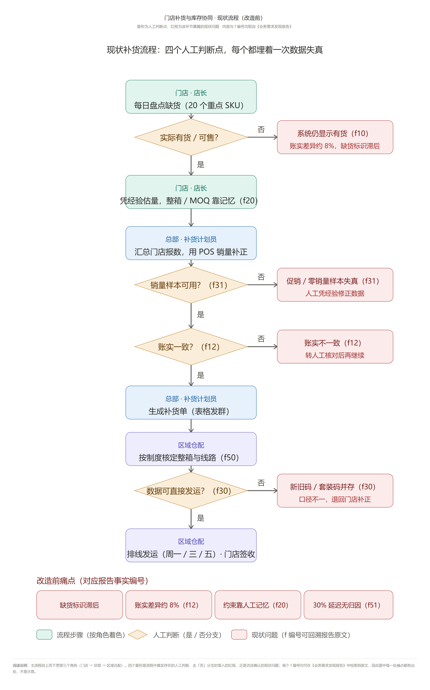
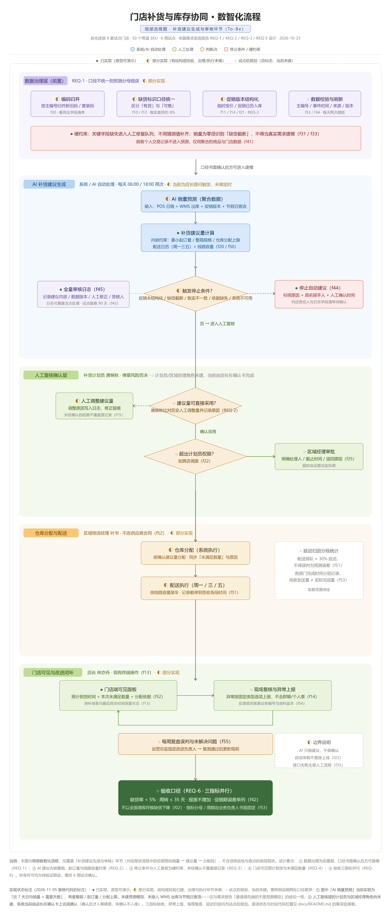

# 门店补货与库存协同智能体

[](https://github.com/Chen-siyuan123/store-replenishment-inventory/actions/workflows/ci.yml)
[](src/2-MVP项目/requirements.txt)
[](tests/test_framework_basics.py)
[](eval/cases_v1.json)
[](LICENSE)

面向社区连锁超市试点门店（8 家）的补货助手：店长用自然语言提问，智能体基于门店库存、销量、补货制度与配送日历给出有依据的建议，最终产物是**补货申请草稿**——先出草稿、店长人工确认、再提交，模型没有任何直接写库权限。

## 测试交付物与线上 MVP

- **MVP 上线地址**：https://store-replenishment-agent.app.workbuddy.host/ （演示账号：店长 `store01` / `store@123`，管理员 `admin` / `admin@123`）
- **量化测试方案**（正常/边界/对抗/权限/故障五类场景，57 条用例 100% 通过）：[`test/1-测试方案/门店补货与库存协同-测试方案.md`](test/1-测试方案/门店补货与库存协同-测试方案.md)（另附同名 docx）
- **五类场景可视化测试过程**（有图有过程）：`test/2-场景测试过程/正常场景测试.docx`、`边界场景测试.docx`、`对抗场景测试.docx`、`权限场景测试.docx`、`故障场景测试.docx`
- **部署说明（上线地址与冒烟报告）**：[`test/3-上线部署/门店补货与库存协同-部署说明.md`](test/3-上线部署/门店补货与库存协同-部署说明.md)（另附同名 docx）
- **一键复现**：`python scripts/run_scenario_tests.py`（离线执行，不调用大模型 API）

## 交付物清单对照

全部交付物按清单编号落位，可逐项对照验收（文档索引见 [`docs/README.md`](docs/README.md)）：

| 编号 | 交付项 | 仓库路径 | 形式 |
|---|---|---|---|
| docs-1 | 六人访谈记录 | [`docs/1-六人访谈记录/`](docs/1-六人访谈记录) | md + json + 3 份 csv |
| docs-2 | 项目的基本简报 | [`docs/2-项目的基本简报/`](docs/2-项目的基本简报) | 4 份 html（客户简报 / 信息请求表 / 访谈问题库 / 干系人与分工） |
| docs-3 | 典型事件资料 | [`docs/3-典型事件资料/`](docs/3-典型事件资料) | docx + 4 轮采访记录 txt |
| docs-4 | 行业分析报告 | [`docs/4-行业分析报告/`](docs/4-行业分析报告) | docx + 同名 md |
| docs-5 | 流程图 | [`docs/5-流程图/`](docs/5-流程图) | 现状图 / 数智化图（html + png） |
| docs-6 | 需求分析方案 | [`docs/6-需求分析方案/`](docs/6-需求分析方案) | 需求定义文档 docx（10 章 / 14 表） |
| docs-7 | 技术架构设计 | [`docs/7-技术架构设计/`](docs/7-技术架构设计) | 系统分层与模块边界 docx |
| docs-8 | 报价单（低 / 中 / 高三档） | [`docs/8-报价单/`](docs/8-报价单) | docx + html + png（¥98,000 / ¥160,000 / ¥260,000） |
| docs-9 | 上线交付运行手册 | [`docs/9-上线交付运行手册/`](docs/9-上线交付运行手册) | 启动部署 / 分角色操作 / 人工审核点 / 应急降级 |
| src-1 | 问答助手归档 | [`src/1-问答助手归档/`](src/1-问答助手归档) | 阶段 1 单脚本原型 + 种子制度文档 |
| src-2 | MVP 项目 | [`src/2-MVP项目/`](src/2-MVP项目) | FastAPI 应用 + agent 框架 + 知识库 + 人工确认点 |
| test-1 | 测试方案 | [`test/1-测试方案/`](test/1-测试方案) | md + docx（五类场景 57 条用例） |
| test-2 | 场景测试过程 | [`test/2-场景测试过程/`](test/2-场景测试过程) | 5 份 docx + 11 张图 + results.json |
| test-3 | 上线部署（含网站地址） | [`test/3-上线部署/`](test/3-上线部署) | md + docx（地址 + 冒烟报告） |

## 项目结构

```
├── src/
│   ├── 1-问答助手归档/        # 清单 src-1：问答助手归档
│   │   ├── replenishment_proto.py  # 阶段 1 单脚本制度问答原型（切片→BM25+FAISS 检索→LLM 回答）
│   │   └── 补货制度.md             # 归档自带的种子制度文档
│   └── 2-MVP项目/             # 清单 src-2：MVP 项目（工程架构 / Agent框架 / 知识库 / 人工确认点）
│       ├── server.py         # FastAPI 入口：SSE 流式问答、HITL 确认、管理后台
│       ├── agent/            # 自研轻量执行循环（Harness）
│       │   ├── harness.py    # 模型决策 → 工具执行 → 结果回填，最多 5 轮；写操作执行前强制中断
│       │   ├── store.py      # agent_runs / agent_steps / agent_actions 轨迹三表
│       │   ├── incidents.py  # 停止条件转交：错误码 → 责任岗位 / 接手人 / 处理时限
│       │   └── scenarios.py  # 离线回放与评测脚本（ScriptedLLM / OfflineKB）
│       ├── tools.py          # 业务工具 + 风险分级（read/verify/write）+ 四重写入门禁
│       ├── kb.py / kbstore.py # 制度知识库：BM25(jieba) + FAISS 混合检索、两级相关性门禁
│       ├── retention.py      # 日志留存：到期先导出 archive/*.jsonl 再删除
│       ├── db.py             # SQLite 建表、种子数据、迁移
│       ├── auth.py           # JWT 登录态 + PBKDF2 密码哈希
│       ├── llm.py            # GLM API 封装（流式 / tool-calling）
│       ├── config.py         # .env 加载 + 中文配置自检
│       ├── templates/        # login / kb / prompts / trace / audit 管理页
│       ├── 补货制度.md        # 种子知识库文档
│       └── run_local.bat     # 一键启动（自动探测 Python、依赖检查、配置自检）
├── docs/                     # 项目文档（按清单编号 1~9 分文件夹，索引见 docs/README.md）
├── test/                     # 测试与上线交付物（按清单编号 1~3）
│   ├── 1-测试方案/            # 量化测试方案（五类场景 57 条用例，md + docx）
│   ├── 2-场景测试过程/        # 五份场景化测试过程 docx + figures 图 + results.json
│   └── 3-上线部署/            # 上线部署说明（含 MVP 访问地址与冒烟报告，md + docx）
├── tests/
│   └── test_framework_basics.py  # 框架层单元测试：数量抽取防线、工具风险分区一致性
├── eval/
│   ├── cases_v1.json         # 30 条评测用例（制度 10 / 工具链 10 / 绕约束 5 / 多轮 5）
│   ├── run_eval.py           # 离线评测一键入口：资产盘点 + 检索预检 + 三条轨迹回归 → eval_report.md
│   ├── probe_retrieval.py    # 制度类检索预检（阈值回归）
│   └── eval_report.md        # 最近一次离线评测报告（自动生成）
├── scripts/
│   ├── export_run_trace.py   # 把 chat.db 里的真实执行轨迹导出成 Markdown 实录
│   └── export_png.py         # 流程图 HTML → PNG（Chrome headless 两阶段截图）
└── output/                   # 文档流水线产物（不入仓库，本地生成）
```

## 核心设计

- **写操作三重防线（模型层之外强制生效）**：`validate_replenishment` 校验通过才签发一次性令牌（MOQ / 整箱 / 分配上限 / 配送日）→ `create_replenishment_draft` 校验令牌内容与申请一致 → 执行前 HITL 中断等店长确认。提示词注入无法绕过：数量由框架层正则独立提取，令牌改一个字段即失效。
- **检索防硬答**：BM25 + 向量两级门禁，相关度不达标直接回答「制度中未找到」，禁止编造条款。
- **业务停止条件**：账实不一致、零销量、新旧编码未归并、促销版本未确认等六类情况工具返回 `blocking=true`，模型必须停下说明原因；同时自动开一张**转交单**（原因 + 接手岗位 + 处理时限），管理后台可查待办、超时与闭环，不会出现「只说了不能办、没人接手」。
- **轨迹可审计**：每轮决策、每次工具调用（参数/耗时/结果摘要）、每次中断确认均落库，管理后台 `/admin/trace` 可查。
- **日志可回收**：`retention.py` 按保留期（默认 90 天）先导出 `archive/*.jsonl` 再删除；补货申请单与未处理转交单不清理。

## 流程与设计

现状流程（四泳道：店长 / 计划员 / 仓库 / 财务，9 个痛点红框，可编辑版见
[`docs/5-流程图/门店补货与库存协同-现状流程图.html`](docs/5-流程图/门店补货与库存协同-现状流程图.html)）：



数智化流程（含判断框与实现状态标注：● 已实现 / ◐ 部分实现 / ○ 试点后规划，可编辑版见
[`docs/5-流程图/门店补货与库存协同-数智化流程图-局部.html`](docs/5-流程图/门店补货与库存协同-数智化流程图-局部.html)）：



系统分层与模块边界见 [`docs/7-技术架构设计/门店补货与库存协同智能体系统-技术架构设计.docx`](docs/7-技术架构设计/门店补货与库存协同智能体系统-技术架构设计.docx)。

## 需求可追溯

需求来自 [`docs/拾光连锁-业务需求发现报告.md`](docs/拾光连锁-业务需求发现报告.md)（36 项事实采集、6 条需求假设 REQ-1~REQ-6）。代码注释与文档中出现的 `f44`、`f52` 等编号即该报告的事实条目，可逐条回溯到原文。

六条需求假设的实现状态（含未实现项的说明）见 [`docs/README.md`](docs/README.md#与代码的对应关系)。

## 本地运行

```bat
cd src/2-MVP项目
run_local.bat
```

脚本会自动探测 Python（含 WorkBuddy 内置版）、检查依赖、自检配置，然后启动服务并打开 `http://127.0.0.1:8765`。

首次使用需复制 `.env.example` 为 `.env` 并填写 `LLM_API_KEY`（智谱开放平台）。**`.env` 已被 gitignore，任何密钥不进仓库。**

默认账号：管理员 `admin / admin@123`，店长 `store01 / store@123`。

## 验证与测试

所有离线验证不调用大模型 API，clone 后即可复现（详见 [`docs/验证与测试报告.md`](docs/验证与测试报告.md)）：

```bash
python -m pytest tests/ -v     # L1 框架层单元测试（数量抽取防线、写操作唯一性）
python eval/run_eval.py        # L2 离线评测：30 条用例资产盘点 + 检索门禁（7/7 命中、3/3 陷阱判空）+ 三条轨迹回归
python scripts/export_run_trace.py   # 列出最近运行；加 --run-id 可导出成 Markdown 实录
```

过程证据不靠截图：[`docs/运行实录-20箱牛奶案例.md`](docs/运行实录-20箱牛奶案例.md) 是把一次真实 5 轮执行（20 箱被拦 → 压到 10 箱 → 建草稿 → 店长确认）从轨迹三表原样导出的，每一轮的入参、返回、校验结论、落库字段都能核对。

每次 push / PR 由 GitHub Actions 自动跑语法检查、单元测试与离线评测，评测报告作为 artifact 保留。

## 状态

**MVP 已上线可演示**（地址见上）：4 轮完成建单、中断确认恢复、离线轨迹回归全过，57 条量化用例 100% 通过，CI 三件套（语法检查 / 单元测试 / 离线评测）每次 push 自动跑。

面向**真实门店试点**仍需完成上线前检查清单中的 6 项加固（限流、令牌持久化、建单幂等、降级开关、知识库软删等），详见 [`docs/门店补货与库存协同-上线前检查清单.html`](docs/门店补货与库存协同-上线前检查清单.html)。清单 v1.1 已按代码复核：日志留存策略实际已实现（`retention.py`），已从阻塞项移出。

管理后台（需 admin 登录）：`/admin` 导航页 → `/admin/kb` 知识库 / `/admin/prompts` 提示词 / `/admin/trace` 执行轨迹 / `/admin/audit` 审计与转交待办。

## 文档与版本

- 文档总索引（按需求 / 设计 / 交付三段归档，含 REQ → 代码追溯表）：[`docs/README.md`](docs/README.md)
- 开发与协作规范（提交格式、代码风格、新增工具的固定四步、安全基线）：[`CONTRIBUTING.md`](CONTRIBUTING.md)
- 版本变更记录：[`CHANGELOG.md`](CHANGELOG.md)
- 许可证：[MIT](LICENSE)
